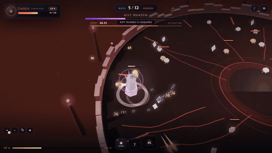
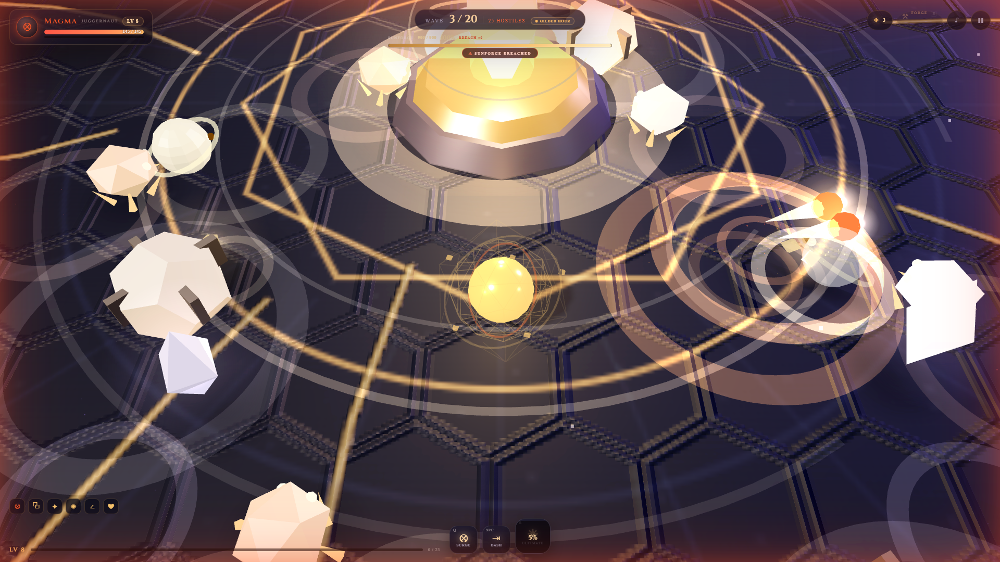
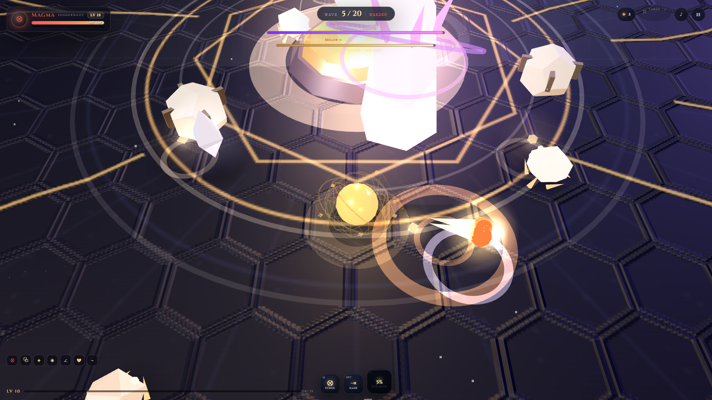
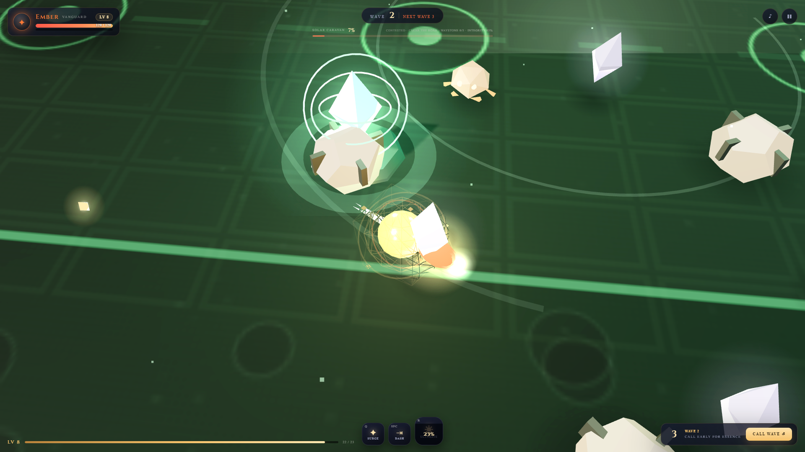
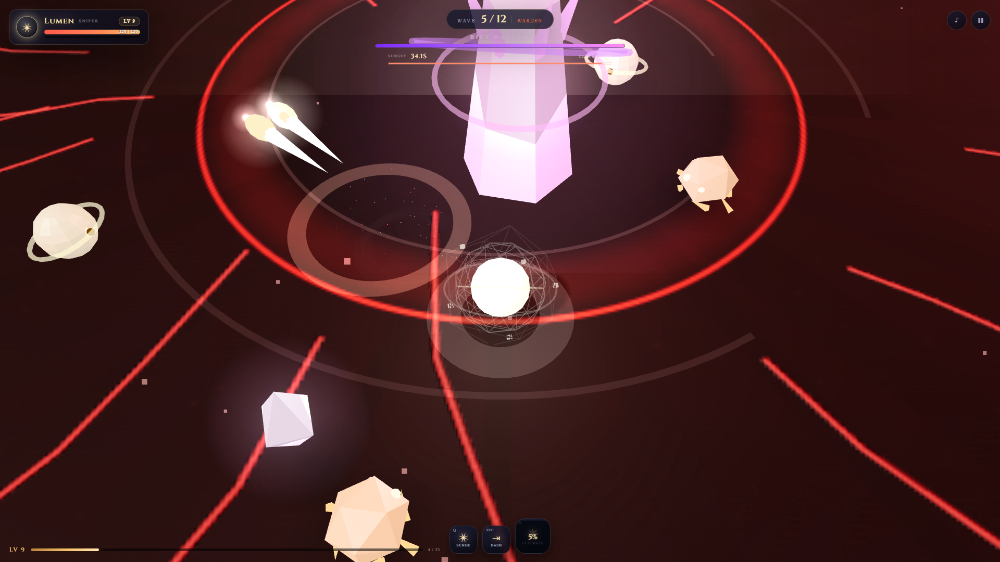
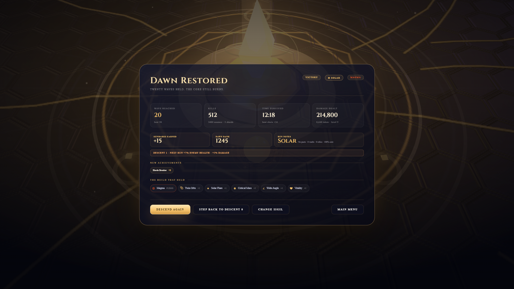
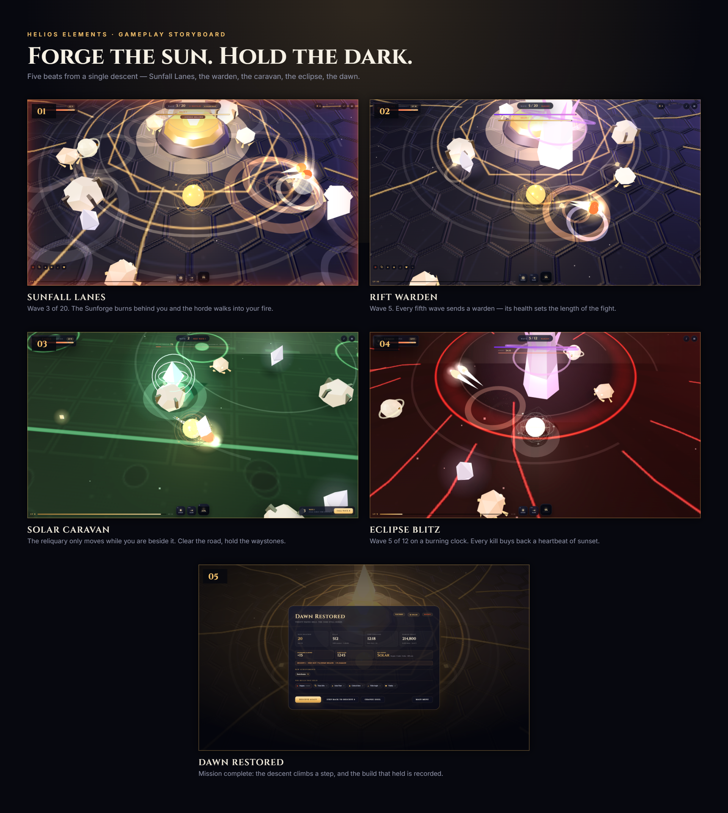
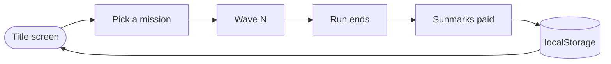

<div align="center">

<sub>B R O W S E R &nbsp; R O G U E L I T E &nbsp; · &nbsp; v 1 . 7 . 4</sub>

# ☀ HELIOS ELEMENTS

**Forge the sun. Hold the dark.**

Six sigils. Five fusions. Eight arenas that want you dead.<br/>
One tab, no install, no account — a 3D roguelite that runs where you already are.

<a href="https://hudmebac.github.io/helioselements/"></a>
<a href="#how-to-play"></a>
<a href="#the-codex"></a>

<br/>


<a href="https://github.com/Hudmebac/helioselements/stargazers"></a>


</div>



<div align="center"><sub><i>Wave 5. The Rift Warden has 24 seconds of patience left. Six seconds of it, looped.</i></sub></div>

---

## What it is

**Helios Elements** is a top-down elemental survival roguelite. You are a sigil-bearer standing in an arena at the end of the world, and the dark is not interested in negotiation. Choose an element, learn what it beats, and turn a shrinking floor into a build that survives twenty waves.

Every run is a negotiation between three clocks: your health, the incoming horde, and the objective you agreed to. Die and you keep your sunmarks. Win and the **Descent** carries you one rank deeper — a harder arena that also pays better. There is no meta-progression treadmill you can grind past the game; the dawn remembers what you learned.

<br/>

<div align="center">

| ⚔ **6** sigils | ⨂ **5** fusions | ✦ **18** armaments | ◈ **29** relics | ✺ **23** boons |
|:---:|:---:|:---:|:---:|:---:|
| ⛨ **8** mission modes | ⌖ **8** arenas | ☄ **4** wardens | ♛ **34** achievements | ⟡ **∞** dawns |

</div>

---

## The gallery

<table>
<tr>
<td width="50%"><br/><sub><b>Sunfall Lanes.</b> Three lanes feed one core. Towers cannot break a Rift Gate — you can.</sub></td>
<td width="50%"><br/><sub><b>The Rift Warden.</b> Every fifth wave, something with a title arrives.</sub></td>
</tr>
<tr>
<td><br/><sub><b>Solar Caravan.</b> Walk a reliquary 205 metres of pilgrim road. It only moves while you do.</sub></td>
<td><br/><sub><b>Eclipse Blitz.</b> Twelve waves on a burning clock. Kills buy seconds.</sub></td>
</tr>
<tr>
<td colspan="2" align="center"><br/><sub><b>The dawn after.</b> Sunmarks, achievements, and the option to descend further — or step back.</sub></td>
</tr>
</table>

<details>
<summary><b>The five-panel storyboard</b> (visual development sheet)</summary>
<br/>
<div align="center"></div>
</details>

---

## Six sigils, five fusions

Each sigil is a different verb. Pick one, then pick **two** — certain pairs collapse into a fusion with its own passive and ultimate.

<table>
<tr>
<th align="left">Sigil</th><th align="left">Role</th><th align="left">Passive</th><th align="left">Ultimate</th>
</tr>
<tr><td><b>✦ Ember</b></td><td>Vanguard</td><td>Attacks burn for 3 damage/s over 2.5s.</td><td>Inferno — nine meteors</td></tr>
<tr><td><b>≈ Tide</b></td><td>Mender</td><td>Shots pierce one foe and mend 0.6 HP on hit.</td><td>Deluge — a healing flood</td></tr>
<tr><td><b>❋ Gale</b></td><td>Tempest</td><td>Bolts leap to one additional enemy.</td><td>Tempest — a roaming storm</td></tr>
<tr><td><b>⬢ Stone</b></td><td>Bulwark</td><td>Shots detonate in a burst of shrapnel and knockback.</td><td>Faultline — three shockwaves</td></tr>
<tr><td><b>✴ Lumen</b></td><td>Sniper</td><td>Lances pierce three targets, +15% crit.</td><td>Radiant Dawn — a turning pillar</td></tr>
<tr><td><b>◈ Umbra</b></td><td>Reaper</td><td>Shots hunt the nearest foe and steal 5% as health.</td><td>Oblivion — open the abyss</td></tr>
</table>

<table>
<tr>
<td align="center" width="20%"><b>⨂ Magma</b><br/><sub>Ember + Stone</sub><br/><sub>Every shot is a detonation.</sub></td>
<td align="center" width="20%"><b>⚡ Storm</b><br/><sub>Ember + Gale</sub><br/><sub>Living lightning, double chains.</sub></td>
<td align="center" width="20%"><b>❄ Frost</b><br/><sub>Tide + Gale</sub><br/><sub>Everything you touch crawls.</sub></td>
<td align="center" width="20%"><b>❦ Verdant</b><br/><sub>Tide + Stone</sub><br/><sub>Living armour that regenerates.</sub></td>
<td align="center" width="20%"><b>◉ Void</b><br/><sub>Lumen + Umbra</sub><br/><sub>Homing pierce that feeds you.</sub></td>
</tr>
</table>

Elements beat the two that follow them around the wheel and are **weak to the two before** — and an attuned arena sends exactly those counters at you. Every element also carries **three armaments**: same element, different shape of violence.

---

## Eight ways to die

<table>
<tr><th align="left">Mission</th><th align="left">The goal</th><th align="left">Arena</th></tr>
<tr><td><b>☀ Sunforge Siege</b></td><td>Hold a failing core for 20 waves. Spend shards on towers; body-block the breach.</td><td>Sunforge Sanctum</td></tr>
<tr><td><b>⌖ Sunfall Lanes</b></td><td>Shatter 3 Rift Gates along three lanes — and keep the core alive while you do.</td><td>Sunfall Reach</td></tr>
<tr><td><b>◈ Endless Trial</b></td><td>No core, no towers, no finish line. Chase your best wave.</td><td>Umbral Colosseum</td></tr>
<tr><td><b>☄ Warden Hunt</b></td><td>Four wardens, back to back, each with an escort. No trash waves.</td><td>Ashfall Basin</td></tr>
<tr><td><b>⛨ Solar Caravan</b></td><td>Escort a reliquary down a 205 m road. It halts at five waystones until the ground is clear.</td><td>Dawn Road</td></tr>
<tr><td><b>◉ Ember Ritual</b></td><td>Charge and seal three circles while the horde tries to take them back.</td><td>Cinder Cloister</td></tr>
<tr><td><b>⌛ Eclipse Blitz</b></td><td>Twelve waves on a burning clock. Every kill adds time.</td><td>Eclipse Ring</td></tr>
<tr><td><b>⚔ Warden Duel</b></td><td>Four crowned champions, alone, no escorts. The last is Helios Unbound.</td><td>Warden's Crown</td></tr>
</table>

Four difficulties (**Kindled → Solar → Umbral → Hardcore**) restack the horde, your purse and the objective timers. **Eclipse Pacts** add up to twenty more ranks of self-inflicted grief for a richer dawn, and **Skill Runs** close the drafts entirely: no boons, no relics, only mastery — for 60% more sunmarks.

---

## The Descent

Complete any mission and the Descent rises one rank, to five. It is the only difficulty that follows you between runs.

| Rank | Horde health | Horde damage | Sunmarks paid |
|:---:|:---:|:---:|:---:|
| 0 | — | — | ×1.00 |
| 1 | +7% | +5% | ×1.15 |
| 2 | +14% | +10% | ×1.30 |
| 3 | +21% | +15% | ×1.45 |
| 4 | +28% | +20% | ×1.60 |
| 5 | +35% | +25% | ×1.75 |

The payout uses the rank you **played**, not the one you just earned, and it is shown on the results screen as `descent ×1.45`. You can **step back down** from the results screen or the mission select at any time.

> [!TIP]
> Descent ranks multiply with difficulty, pacts and the skill-run bonus — a Hardcore run at rank 5 pays **×3.50** before anything else.

---

## How to play

<p><kbd>W</kbd> <kbd>A</kbd> <kbd>S</kbd> <kbd>D</kbd> move &nbsp;·&nbsp; aim with the mouse &nbsp;·&nbsp; attacking is automatic</p>

Every run opens on an **empty arena** and begins on its own after **three seconds** — enough time to read the tier and walk the ground. Press <kbd>Enter</kbd> — or **Begin now** — to start the horde immediately.

| Keys | Action |
|:---|:---|
| <kbd>Space</kbd> / <kbd>Shift</kbd> | **Dash** — brief invulnerability, and Burst Dash turns it into a bomb |
| <kbd>Q</kbd> | **Elemental surge** — your sigil's signature move |
| <kbd>R</kbd> | **Ultimate** — when the sun is fully charged |
| <kbd>B</kbd> / <kbd>F</kbd> | **The Forge** — raise and upgrade towers (Siege, Lanes) |
| <kbd>E</kbd> (hold) | **Repair** the Sunforge, a tower or a lane pad |
| <kbd>Enter</kbd> | **Begin wave 1** · then **call the next wave early** — more danger, more shards |
| <kbd>L</kbd> | Open a stored level-up draft |
| <kbd>Esc</kbd> / <kbd>P</kbd> | Pause |

All twelve actions are rebindable in **Settings → Controls**. **Settings → Interface → Menus** sets how much the game asks of you: *Simple* (four missions, one difficulty), *Default* (six missions, four difficulties, weapon choice) or *Complex* (all eight missions, Eclipse Pacts, Skill Runs, the full Codex).

> [!NOTE]
> Progress lives in `localStorage` (`helios.elements.save.v1`) — there is no cloud. **Settings → Save** exports your progress as text or a file and imports it back, so clearing site data is no longer fatal.

---

## The Codex

> The archive below is what the Dawn Codex remembers. It is not a history — the Eclipse took the history. It is what was written down afterwards, by the people who kept the light on.

<table>
<tr>
<td align="center" width="50%"><b>The Long Dawn</b><br/><sub><i>Before</i></sub></td>
<td align="center" width="50%"><b>The Eclipse</b><br/><sub><i>The wound</i></sub></td>
</tr>
<tr>
<td align="center"><b>The Sunforge</b><br/><sub><i>The hold</i></sub></td>
<td align="center"><b>The Six Sigils</b><br/><sub><i>The six</i></sub></td>
</tr>
<tr>
<td align="center"><b>The Forged Forms</b><br/><sub><i>The fusion</i></sub></td>
<td align="center"><b>The Horde</b><br/><sub><i>The children</i></sub></td>
</tr>
<tr>
<td align="center"><b>The Wardens</b><br/><sub><i>The crown</i></sub></td>
<td align="center"><b>The Pilgrim Road</b><br/><sub><i>The road</i></sub></td>
</tr>
<tr>
<td align="center"><b>The Ember Circles</b><br/><sub><i>The ritual</i></sub></td>
<td align="center"><b>The Last Hour</b><br/><sub><i>The clock</i></sub></td>
</tr>
<tr>
<td align="center"><b>The Ring</b><br/><sub><i>The duel</i></sub></td>
<td align="center"><b>The Descent</b><br/><sub><i>The climb down</i></sub></td>
</tr>
<tr>
<td align="center"><b>The Dawn Codex</b><br/><sub><i>The account</i></sub></td>
<td align="center"><sub>read it in game, or on the <a href="site/index.html">marketing site</a></sub></td>
</tr>
</table>

Thirteen chapters, a ten-part field guide, an FAQ and the changelog all live in **`js/codex.js`** — the in-game Codex and the site are both rendered from that one file, so they can never disagree.

---

## Under the hood

No framework, no bundler, no `node_modules`. Plain ES modules and a vendored Three.js, served by a 60-line static server.



A run is closed: waves feed the results screen, the dusk pays out on the rank you played, and the save carries the Descent back to the title screen.

<details>
<summary><b>Repository map</b></summary>

```text
helioselements/
├── index.html            the game
├── server.js             static server, directory → index.html
├── css/
│   ├── style.css         shell, HUD, menus
│   ├── sunforge.css      Siege and Lanes interfaces
│   └── eclipse.css       results, Descent, codex prose
├── js/
│   ├── main.js           boot
│   ├── engine.js         renderer, camera, loop
│   ├── game.js           run state, waves, win/lose, rewards
│   ├── data.js           every number in the game
│   ├── entities.js       enemies, projectiles, pickups
│   ├── player.js         movement, weapons, surges, ultimates
│   ├── enemies.js        enemy behaviour
│   ├── structures.js     towers, core, gates, reliquary, shrines
│   ├── vaults.js         Sunless Vaults
│   ├── fx.js             particles, shake, damage numbers
│   ├── audio.js          synthesised sound, no audio files
│   ├── store.js          save shape, normalise, export/import
│   ├── ui.js             every screen
│   ├── codex.js          all copy: lore, guide, FAQ, changelog
│   └── lib/three.min.js  vendored
├── site/                 marketing site, reads js/codex.js
└── marketing/            storyboard, screenshots, capture
```

</details>

The Codex is a single source of truth: `js/codex.js` feeds the in-game Codex **and** the marketing site, so lore, changelogs and FAQ answers never drift apart. The game's balance lives entirely in `js/data.js` — no logic is hidden in magic numbers.

---

## Run it locally

No build step and no dependencies — Node 18+ is enough.

```bash
git clone https://github.com/Hudmebac/helioselements.git
cd helioselements
npm start          # or: node server.js
```

Then open **http://localhost:8091** for the game and **http://localhost:8091/site/** for the marketing site. Set `PORT` to move it.

<details>
<summary><b>Deploying to GitHub Pages</b></summary>

The repo root is already a working static site, so **Settings → Pages → Deploy from a branch → `main` / `/ (root)`** serves the game at <https://hudmebac.github.io/helioselements/> and the marketing site at `/site/`.

The **Play** button at the top of this README already points there; the canonical link in `site/index.html` is the only other place the URL appears.

</details>

---

## Changelog

<details open>
<summary><b>v1.7.6 — What the dead leave behind</b></summary>

- **Kindling**: kills can shed a burning mote. Eight of them summon a **Dawn Gift** — +35% damage for 18 seconds, tracked by a HUD meter next to the shard count. Elites drop three, wardens four.
- **Gifts answer the mission**: two shards and a mended core in Sunforge Siege, +4s on the clock in Eclipse Blitz, reliquary repair in Solar Caravan, a circle charge in Blind Ritual — and every second gift sends a wisp to fight beside you.
- **Fallen bodies dissolve**: an ash puff at the moment of death, then a shrink and sink that clears the arena in 7 seconds (10 for elites, 16 for wardens) instead of lingering.
- **Runs begin on their own**: wave 1 starts three seconds after the arena opens, with the countdown on the HUD — <kbd>Enter</kbd> still starts it immediately.
- **Characters read their element**: the guardian carries its sigil and element name overhead, every enemy wears its element's sigil and a red hostile ring underfoot, and weapons fire their own silhouette (bolt, blade, needle, boulder) from a crystal focus that kicks with every shot.
- **Caravan wayfinder**: an arrow now floats above the reliquary and points at the next checkpoint — the next unlit waystone, then the eastern rift — with a soft ground ring marking exactly where you must stand (green clear, red contested).
- **Two new wardens and mini-bosses**: Cinder Tyrant and Stormglass Seraph join the rotation, deeper tiers meet them sooner, and every third wave sends a crowned Cinder Herald or Glass Revenant ahead of the horde.
- **Essence buys less**: the level curve is roughly 60% longer, and a draft earned mid-wave is stored and opened when the wave clears.
- **Two arms and a ward**: you carry two weapons — the second fires slower for 60% damage at 85% reach — plus a single defence (Aegis, Briar, Pyre or Tidewell) that shields you, reflects contact damage, burns the crowd or mends you. The HUD lists all three with their ranks.
- **Ranks are drafted, not automatic**: each level offers a rank to whichever piece is furthest behind — +16% damage per weapon rank, rarity following the rank — so you choose whether to push one arm to legendary or keep both growing. Replacements at levels 5, 9 and 13 still restart at rank 1.
- **Shorter reach, closer fights**: shots travel about a quarter less far, but a shot fired inside six paces hits 14% harder, and waves trickle in over a longer window instead of arriving as one wall.

</details>

<details>
<summary><b>v1.7.5 — Three depths of menu</b></summary>

- **Settings → Interface → Menus**: *Simple* (four missions, one difficulty, no pacts or skill runs), *Default* (six missions, all four tiers, the Descent and weapon choice) and *Complex* (all eight missions, Eclipse Pacts, Skill Runs and the full Codex).
- A hidden system is switched off at run start instead of silently applying, so a lean menu can never run a hardcore pact build underneath.
- Runs open on an empty arena: wave 1 no longer counts down — it waits for <kbd>Enter</kbd> or the **Begin** button, and objectives can't be drained or pre-charged before it starts.

</details>

**Earlier — v1.7.5:** three menu depths and the empty-arena wave gate. **v1.7.4:** the Descent multiplier (+15% per rank, paid on the rank *played*) and **Settings → Save** export/import. Before that: the Descent itself, Solar Caravan's eight-point road, level boons, Eclipse Pacts, Skill Runs, Warden Duel, and the Codex.

---

<div align="center">

### Roadmap

- [ ] Cloud saves
- [ ] Daily seed
- [ ] Endless Descent
- [ ] More wardens
- [ ] Controller support

<br/>

**Built with** Three.js (MIT) · Cinzel & Inter (OFL) · everything else hand-built — renderer, audio synthesis, UI and lore.<br/>
<sub>Helios Elements v1.7.6 · no install, no account, no telemetry.</sub>

</div>
